# 广理职小鱼 使用手册

客户端版本 1.0.4 · 2026 年 11 月

本手册的截图来自客户端的演示数据，商品、人名、金额都是示例。

## 1. 软件简介

广理职小鱼是一个校园二手交易平台，同学之间可以发布闲置、搜索商品、私信聊天、下单购买。

- 服务器用 C 语言编写，运行在云服务器上；客户端是用 C# WPF 编写的 Windows 程序。
- 平台里的余额和付款都是**模拟**的，不涉及真实的钱。
- 商品和私信有内容安全审核：敏感词直接拦截，其余由 AI 辅助判断，拿不准的交给管理员。

## 2. 运行环境与启动

### 2.1 运行环境

| 项目 | 要求 |
|---|---|
| 系统 | Windows 10 或 Windows 11，64 位 |
| 网络 | 需要连接互联网，客户端和服务器之间的通信是加密的 |
| 安装 | 不用安装，也不用另装 .NET，一个 exe 双击就能运行（约 64 MB） |

### 2.2 获取和启动

1. 从门户网站 https://xiaoyu.aaalez.com 下载客户端，或者直接使用我们提供的 exe 文件。
2. 双击 exe 运行。第一次启动要解压运行库，需要等几秒。
3. 出现登录窗口就说明启动成功了。

### 2.3 打不开怎么办

| 现象 | 处理方法 |
|---|---|
| 提示"Windows 已保护你的电脑" | 程序没有购买代码签名证书，Windows 对这类程序统一这样提示。点"更多信息"，再点"仍要运行" |
| 提示被"智能应用控制"阻止 | 部分新装的 Windows 11 开启了"智能应用控制"，会直接阻止没有签名的程序，没有"仍要运行"的选项。请换一台电脑运行 |
| 浏览器提示"不常下载"或"可能有害" | 同样是因为程序没有签名，在浏览器的下载列表里选"保留" |
| 登录时提示连不上服务器 | 检查网络。使用了代理或校园网认证的，确认已经连上互联网 |

## 3. 账号

### 3.1 注册

在登录窗口点"注册新账号"。

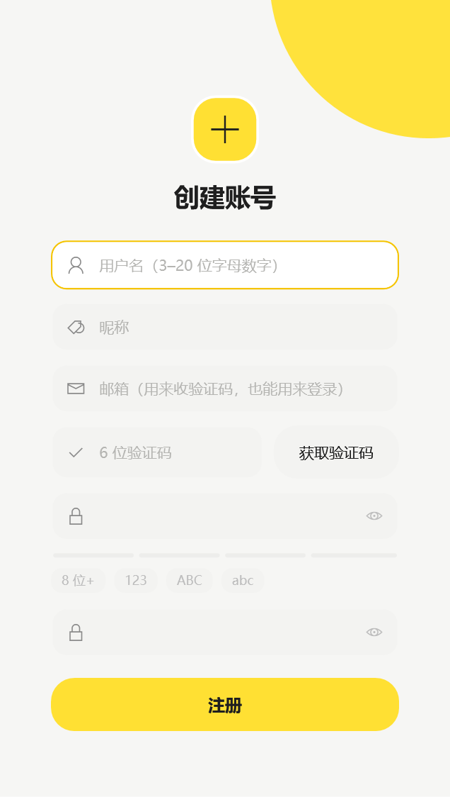

1. **用户名**：3–20 位，只能用字母、数字、下划线，注册后不能改。
2. **昵称**：1–20 个字，会显示给其他同学看。
3. **邮箱**：填好后点"获取验证码"，邮箱会收到一封带 6 位验证码的邮件。验证码 10 分钟内有效，60 秒后才能重新获取。没收到的话，先看看垃圾邮件箱。
4. **验证码**：填邮件里的 6 位数字。
5. **密码**：8–32 位，必须同时包含数字、大写字母和小写字母。输入框下面的四格会随着输入亮起，提示还缺什么。
6. **再输一次密码**，点"注册"。

注册成功后会回到登录窗口，用户名已经帮你填好。

### 3.2 登录

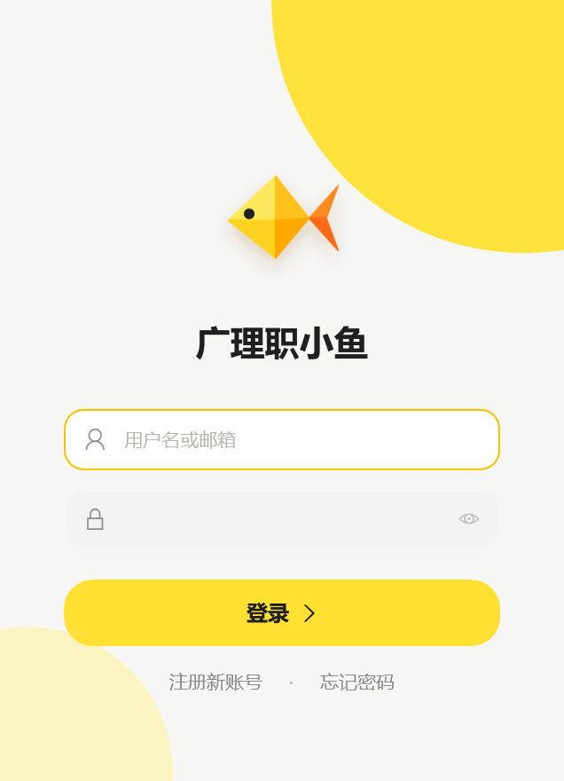

输入用户名**或**邮箱，再输入密码，点"登录"或按回车。

所有密码框右边都有一个小眼睛：点一下显示密码，方便检查有没有输错；再点一下就隐藏。

### 3.3 忘记密码

在登录窗口点"忘记密码"。

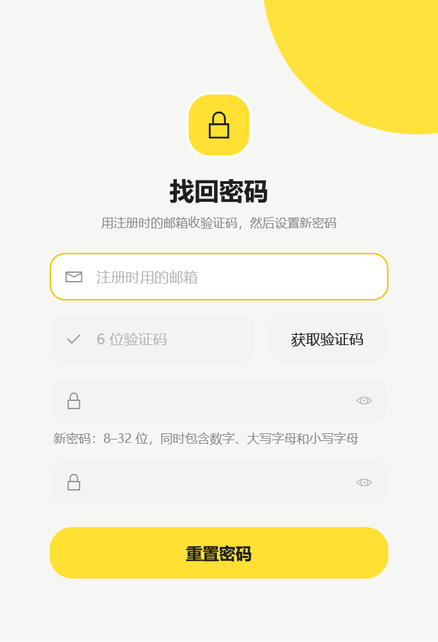

1. 填注册时用的邮箱，点"获取验证码"。
2. 填邮件里的 6 位验证码。
3. 输入新密码两次（规则和注册时一样），点"重置密码"。

重置成功后回到登录窗口，邮箱已经填进用户名框，输入新密码即可登录。

### 3.4 修改密码、退出登录

在"我的"页面，资料卡片右上角有三个按钮：铅笔（编辑资料）、锁（修改密码）、电源（退出登录）。

- **修改密码**：点锁，输入原密码和两次新密码，点"确定修改"。改完以后，其他电脑上的登录会失效。
- **退出登录**：点电源按钮，确认后回到登录窗口。

## 4. 主界面

登录后进入主界面。

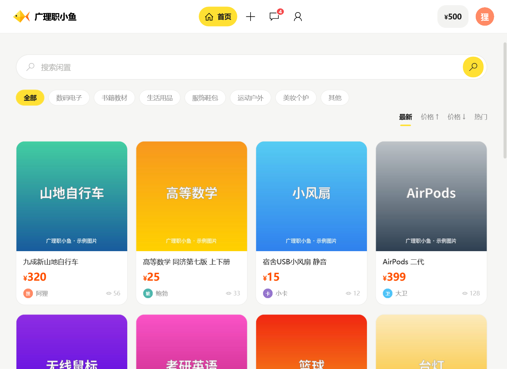

顶部一栏从左到右：

| 位置 | 内容 |
|---|---|
| 左边 | 返回按钮（进入下一级页面后出现）、小鱼标志 |
| 中间 | 四个图标：首页、发布、消息、我的。当前所在的页面会高亮并显示文字；有未读消息时，消息图标上有红色数字 |
| 右边 | 余额；头像（点了也会进入"我的"） |

断网时顶部会出现橙色提示"连接断开，正在重连…"，网络恢复后自动重连，不需要重新登录。

有新私信、订单状态变化、商品审核结果时，窗口底部会浮出一条提示，几秒后自动消失。

## 5. 逛和买

### 5.1 首页：搜索、分类、排序

- **搜索**：在搜索框输入关键词（最多 30 个字），按回车或点右边的放大镜。标题或描述里包含这个词的商品都会列出来。
- **分类**：搜索框下面一排分类：全部、数码电子、书籍教材、生活用品、服饰鞋包、运动户外、美妆个护、其他。
- **排序**：右边可以选"最新""价格 ↑""价格 ↓""热门"，热门按浏览量排序。
- 每张卡片显示封面、标题、价格、卖家和浏览量。拉到底部点"加载更多"可以看更多商品。
- 点卡片进入商品详情。

### 5.2 商品详情

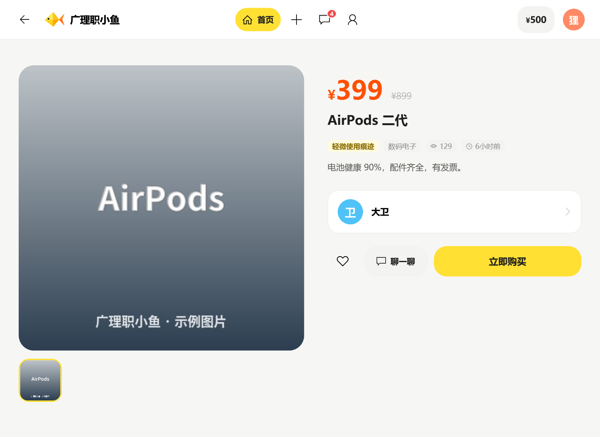

- 左边是大图，下面的小图可以点击切换。
- 右边是价格（旁边划线的是原价）、标题、成色、分类、浏览量、发布时间和描述。
- 卖家卡片：点击进入卖家主页。
- 底部三个按钮：
  - **爱心**：收藏，再点一次取消收藏。收藏的商品在"我的 → 我的收藏"里能找到。
  - **聊一聊**：和卖家私信，聊天窗口顶部会带上这件商品。
  - **立即购买**：见 5.4。

### 5.3 卖家主页

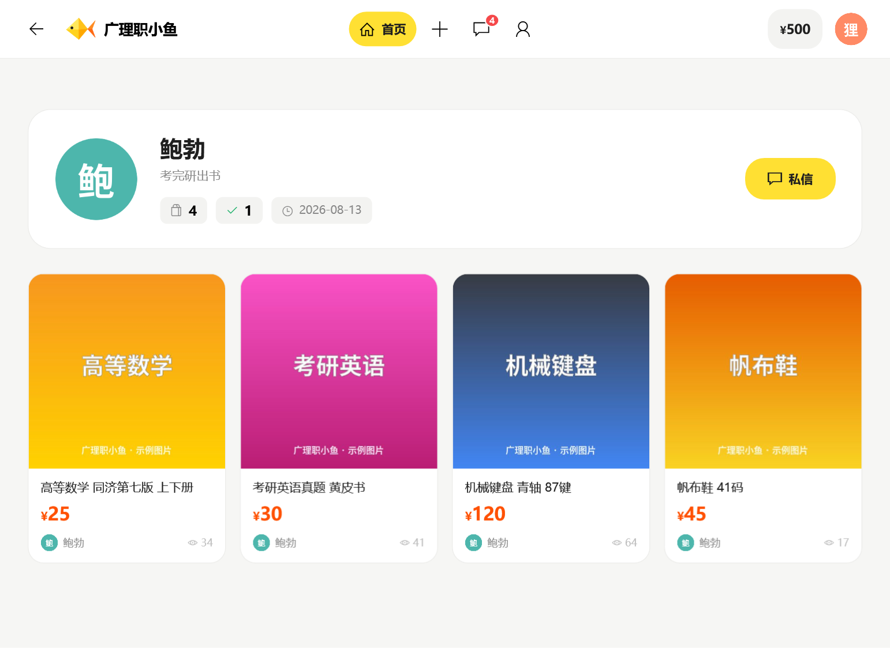

显示卖家的头像、昵称、简介，以及**在售数量、已卖出数量**和加入时间，方便判断卖家靠不靠谱。下面列出他正在卖的商品。点"私信"可以直接和他聊天。

### 5.4 下单购买

1. 在商品详情点"立即购买"。
2. 确认框会提示："款项会先由平台保管，确认收货后才打给卖家"。点确定。
3. 余额够的话提示"下单成功"，余额立刻扣掉，商品下架，不会再被别人买走。余额不够会提示"余额不足，去「我的」充值吧"。

如果多人同时购买同一件商品，只有一个人能成功，其他人会收到提示，钱不会被扣。

下单之后怎么收货，见第 9 节。

## 6. 卖闲置

### 6.1 发布

点顶部的"＋"（发布）。

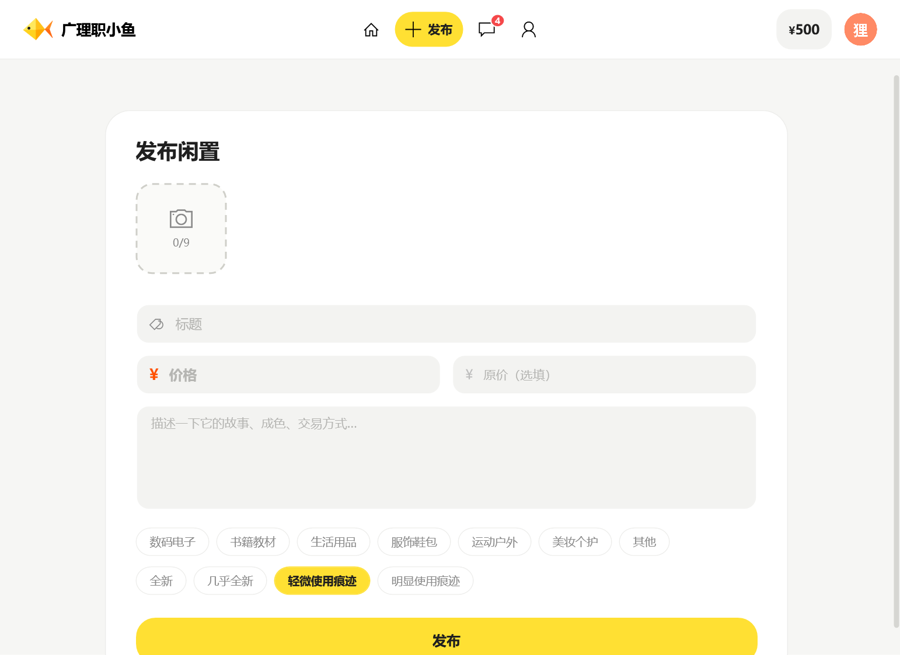

1. **图片**：点虚线方框，在弹出的窗口里选图片，可以一次选多张，最多 9 张。第一张是封面。图片会自动压缩后上传，几 MB 的照片也只要零点几秒。点图片右上角的叉可以删掉。
2. **标题**：1–30 个字。
3. **价格**：0.01–999999 元，最多两位小数。**原价**选填。
4. **描述**：最多 500 个字，可以写成色、交易方式等。
5. **分类**：必选一个。**成色**：全新、几乎全新、轻微使用痕迹、明显使用痕迹。
6. 点"发布"。

### 6.2 AI 审核

发布后商品先进入"审核中"，提示"已提交，AI 正在审核，通过后自动上架"。

- 通常几秒钟就有结果。通过后商品自动上架，并弹出提示"你发布的商品审核通过，已经上架"，停在详情页的话页面会自动刷新。
- 标题或描述里有禁售的词（比如代课代写、违禁品），点发布时会直接提示"商品包含禁售内容……不能发布"，改掉再发。
- AI 有把握判定违规的，商品会被驳回，见 6.4。
- AI 拿不准或暂时连不上时，商品会先上架，再由管理员人工复核。

### 6.3 编辑、下架、重新上架

打开自己的商品，详情页底部是"编辑"和"下架"。

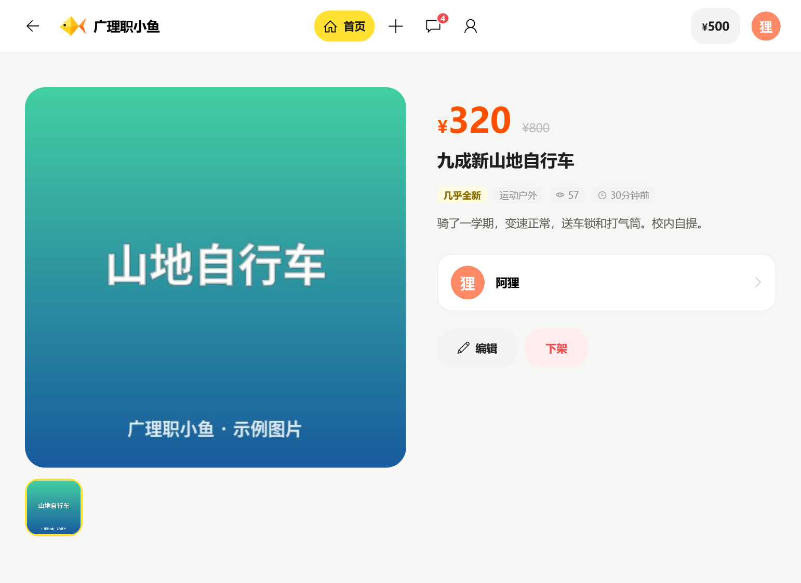

- **编辑**：可以改图片、标题、价格、描述、分类、成色。改了内容会重新审核。
- **下架**：别人就看不到这件商品了。下架后按钮变成"重新上架"。
- 自己发布的所有商品都在"我的 → 我发布的"里，卡片上会标出审核中、已驳回、已下架、已卖出等状态。商品不会被删除。

### 6.4 被驳回了怎么办

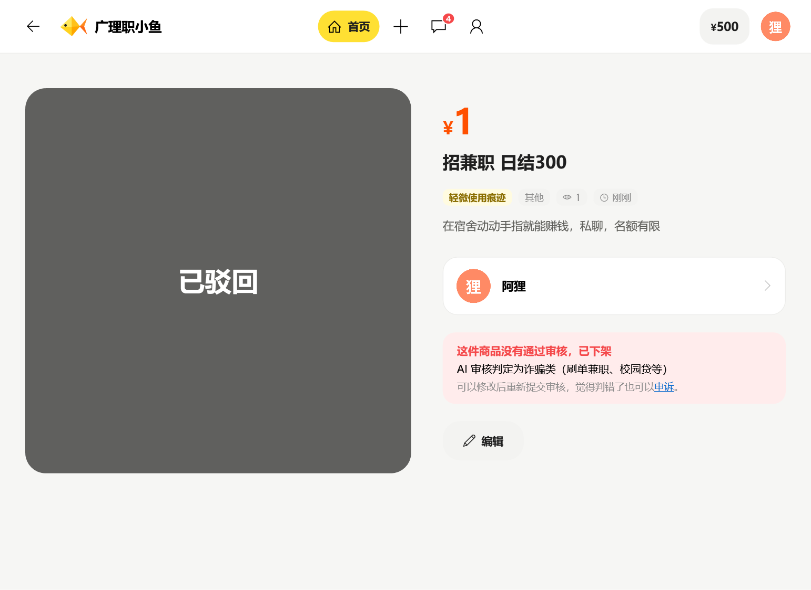

被驳回的商品会自动下架，详情页用红色写明驳回原因。

- 修改后重新提交：点"编辑"，改完保存后会重新审核。
- 觉得判错了：点红框里的"申诉"，写明理由（必填，最多 200 字），管理员会人工复核。

## 7. 消息

### 7.1 消息列表和聊天

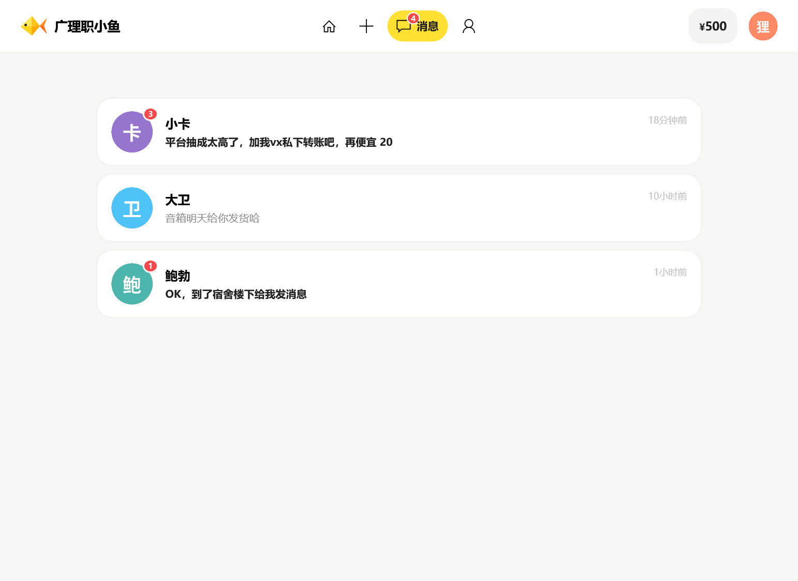

点顶部的消息图标，列出所有聊过天的人，按最近消息排序，未读消息头像上有红点数字。点一个人进入聊天。

- 聊天窗口顶部是聊的那件商品，点它可以回到商品详情。
- 在下面的输入框里输入消息，按回车或点发送按钮发送（Shift + 回车是换行），一条最多 500 个字。
- 对方发来的新消息会实时出现，不用刷新。往上翻到顶可以点"查看更早的消息"。

### 7.2 风险提醒和举报

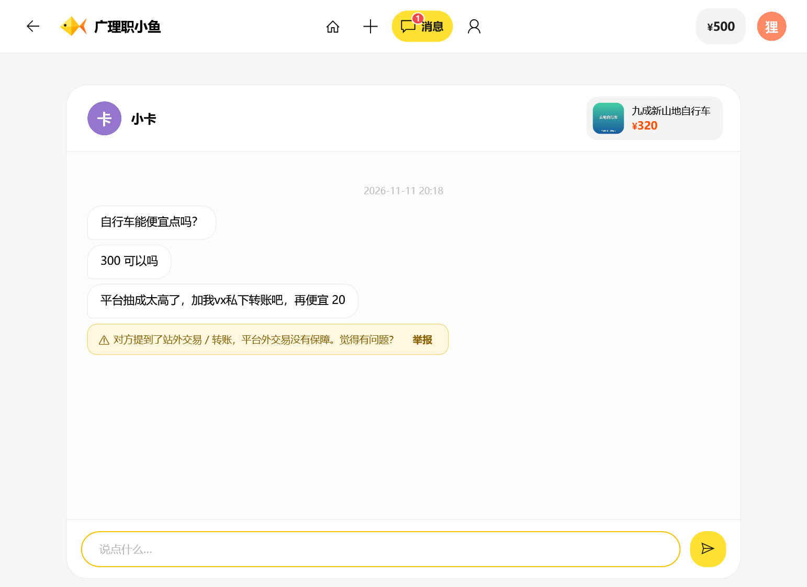

- 含有辱骂、色情、政治敏感等词的消息发不出去，会提示"消息包含违规内容……发送失败"。
- 对方的消息里如果提到**加微信、私下转账**，或者有威胁、骚扰的内容，消息下面会出现黄色提醒，比如"对方提到了站外交易 / 转账，平台外交易没有保障。觉得有问题？"。
- **举报**：点黄色提醒里的"举报"，或者把鼠标移到对方的某条消息上，点旁边出现的"举报"。选择举报类型，写明理由（必填，最多 200 字）后提交。
- 举报后 AI 会先判断。举报成立时，对方的那条消息会被屏蔽（显示"该消息因违规已被屏蔽"），对方被禁言 12 小时；不成立会自动驳回；拿不准的交给管理员。结果会通过提示告诉你。

### 7.3 被禁言和申诉

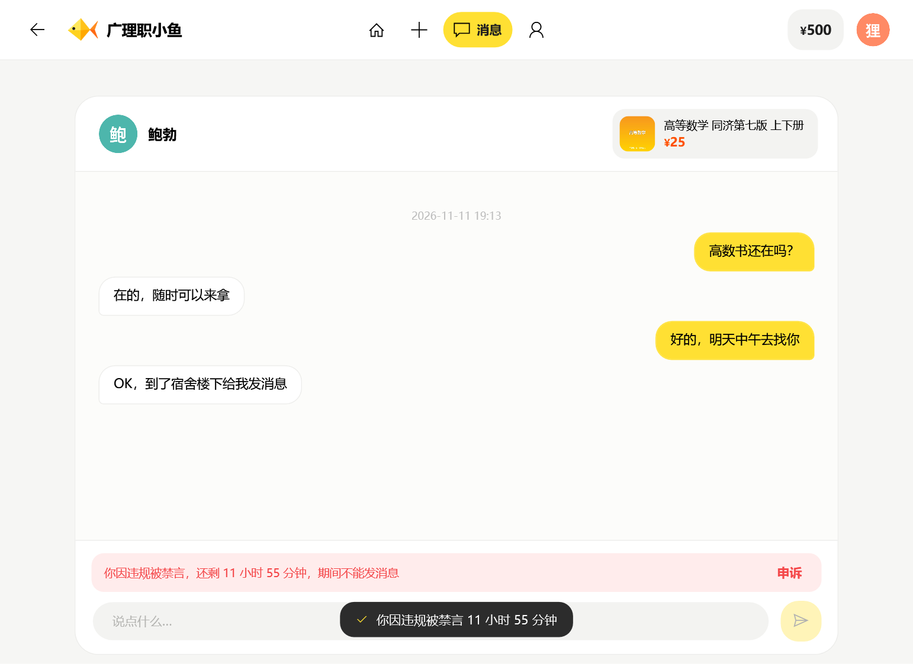

被禁言期间，聊天窗口底部显示红色提示和剩余时间，不能发消息。觉得冤枉的话，点红色提示右边的"申诉"，写明理由，管理员会人工处理。禁言到期后自动解除；管理员提前解除时，会弹出提示"禁言已解除"。

## 8. 我的

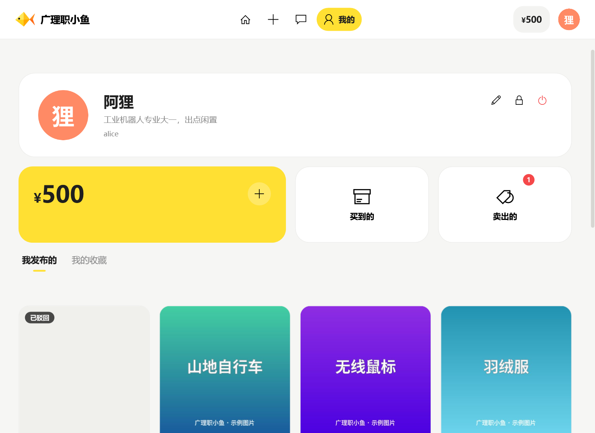

### 8.1 资料和头像

点资料卡片右上角的铅笔进入编辑：

- **换头像**：选一张图片，自动上传。
- **昵称**：1–20 个字。**简介**：最多 100 个字。
- 点"保存"或"取消"。

昵称和简介也会经过审核。AI 判定违规时，昵称会被重置成"小鱼用户 + 编号"，简介被清空，24 小时内不能再改昵称。

### 8.2 余额和充值

黄色卡片上是当前余额。点右上角的"＋"，选择 +50、+100、+500 或 +1000 即可充值。这是**模拟充值**，不用付钱。

### 8.3 订单入口、发布和收藏

- **买到的**、**卖出的**：进入订单列表。有待收货、待发货的订单时，右上角有红点。
- 下面两个标签：**我发布的**（自己所有的商品，含各种状态）和**我的收藏**。

## 9. 订单

### 9.1 订单列表和状态

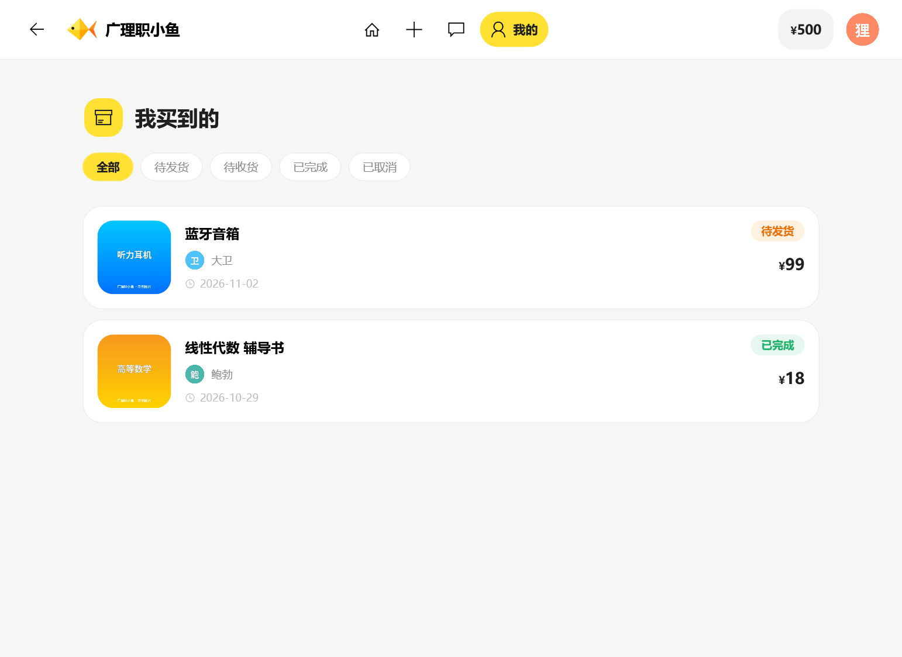

订单列表上方可以按状态筛选：全部、待发货、待收货、已完成、已取消。点订单进入详情。

订单的流程是：**已付款（待发货）→ 已发货（待收货）→ 已完成**。付款后、发货前，买卖双方都可以取消订单。每次状态变化，对方都会收到提示。

### 9.2 卖家发货

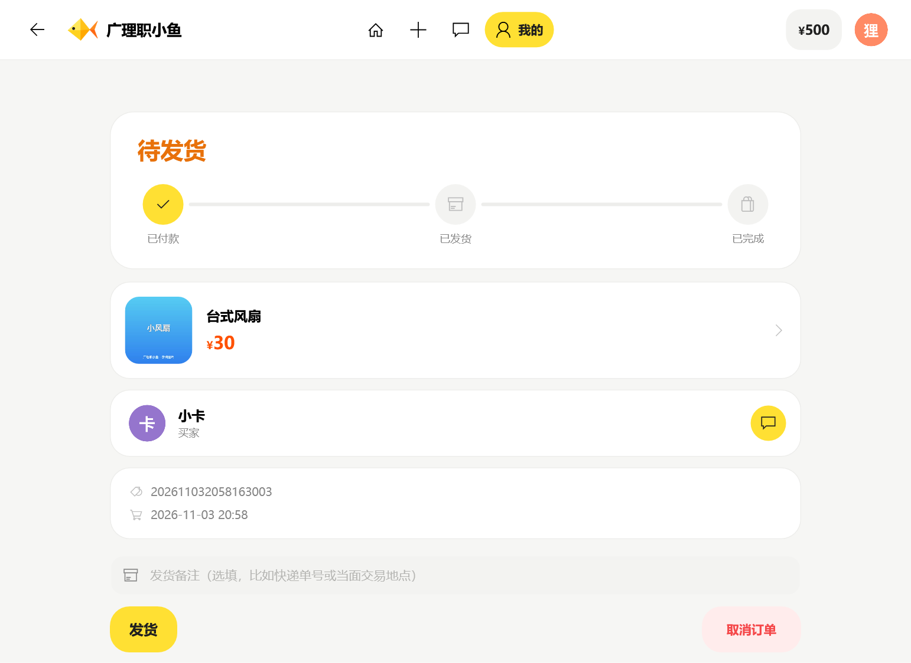

卖家打开"待发货"的订单，可以在"发货备注"里写快递单号或当面交易的地点（选填），然后点"发货"并确认。订单变成"待收货"，之后双方都不能再取消订单。

### 9.3 买家确认收货

买家拿到东西后，打开"待收货"的订单，点"确认收货"并确认。货款这时才打给卖家，订单变成"已完成"。

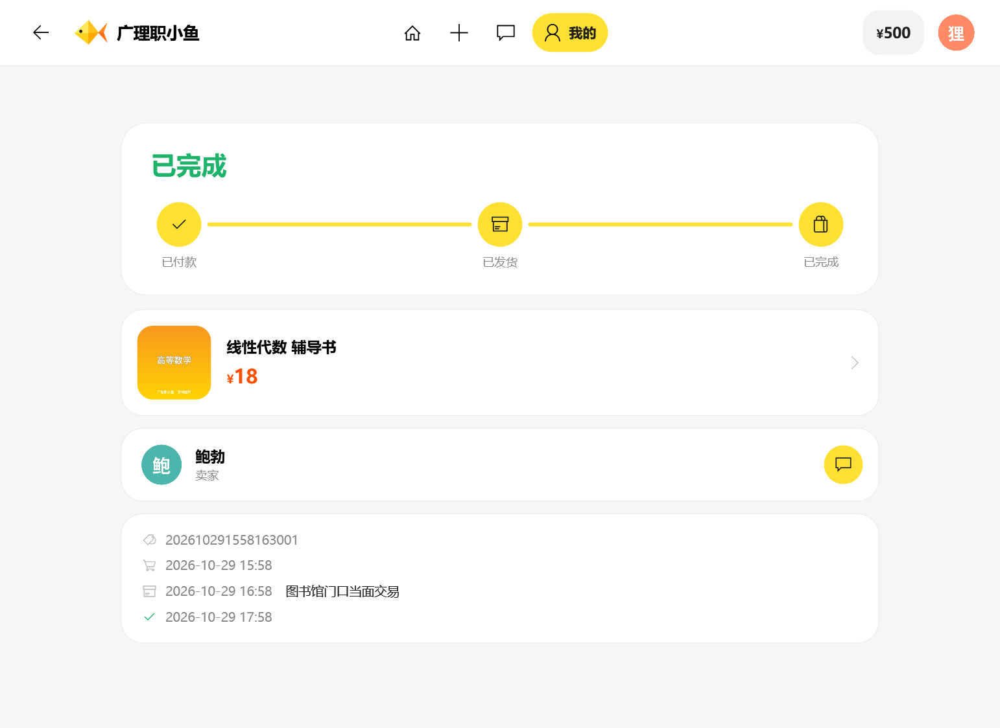

### 9.4 取消订单

订单在"待发货"时，买家或卖家都可以点"取消订单"。取消后货款退回买家，商品重新上架。卖家发货后就不能取消了。

订单详情里的对方卡片右边有聊天按钮，可以直接私信对方。

## 10. 管理员：审核后台

审核后台是一个网页，地址是 https://admin.aaalez.com ，只有管理员账号能登录。普通用户不需要使用。

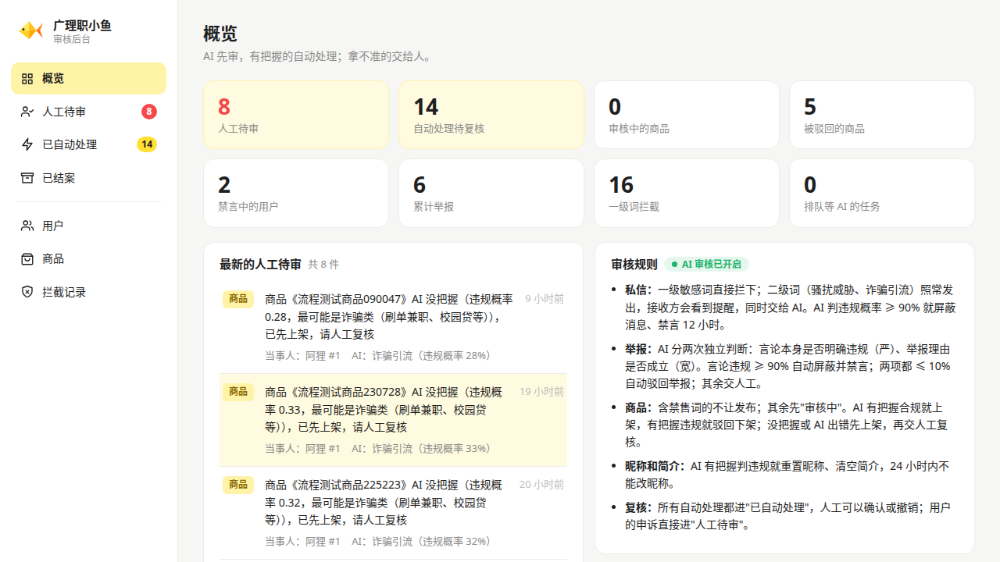

| 页面 | 用途 |
|---|---|
| 概览 | 待处理数量、审核中和被驳回的商品数、禁言中的用户数等，以及审核规则说明 |
| 人工待审 | AI 拿不准或调用失败的内容，以及用户的申诉，需要管理员处理 |
| 已自动处理 | AI 有把握时已经自动处理的案件（屏蔽禁言、驳回商品、重置昵称、驳回举报），管理员复核：没问题就结案，判错了可以撤销 |
| 已结案 | 处理过的案件和处理结果 |
| 用户 | 搜索用户，查看禁言状态，可以给禁言加时或解除 |
| 商品 | 所有商品，包括审核中和被驳回的 |
| 拦截记录 | 命中敏感词、没有发出去的内容 |

点一个案件进入详情：

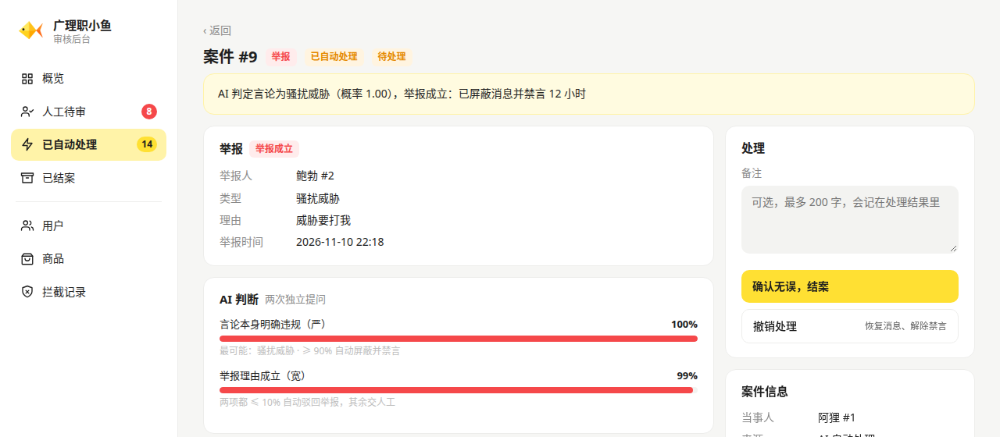

页面上能看到举报内容、AI 两次判断的概率、对话上下文（被举报的那条会标出来）。右边是处理按钮，按案件类型不同，可以选择"确认无误，结案""撤销处理""屏蔽并禁言""审核通过，上架""驳回下架""同意申诉""驳回申诉"等，并可以写备注。屏蔽禁言、解除禁言、商品恢复上架等结果会实时推送给相关用户。

## 11. 常见问题

**收不到验证码？** 先看垃圾邮件箱。验证码 10 分钟内有效，过期了重新获取。

**密码一直提示不符合要求？** 密码要 8–32 位，并且同时有数字、大写字母、小写字母，比如 `Xiaoyu2026`。

**余额是真的钱吗？** 不是。充值和付款都是模拟的。

**商品一直显示"审核中"？** 通常几秒钟就有结果。AI 暂时不可用时，商品会先上架，再由管理员复核。

**改完密码后，另一台电脑被退出登录了？** 这是正常的安全措施，用新密码重新登录即可。

**被误判禁言或驳回了？** 在聊天窗口或商品详情页点"申诉"，管理员会人工处理。
